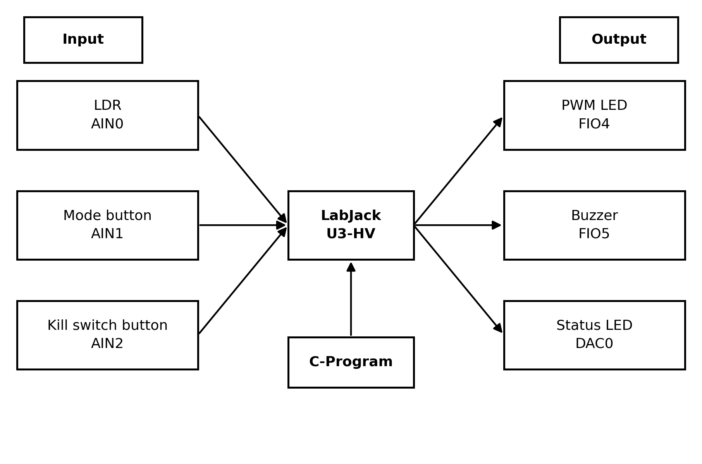
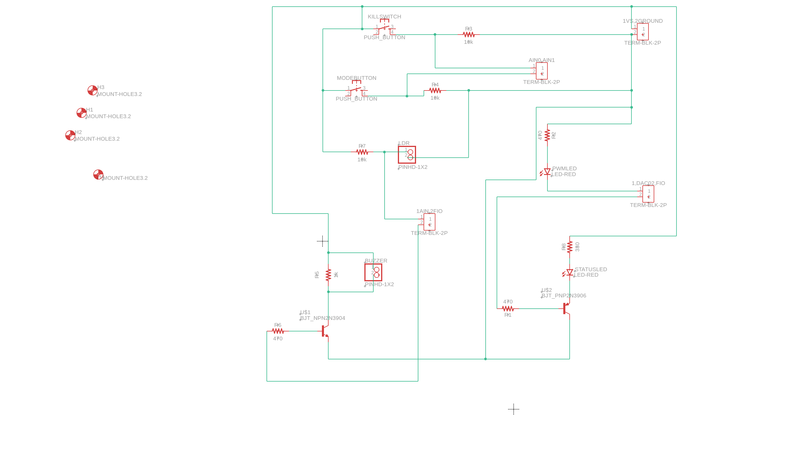
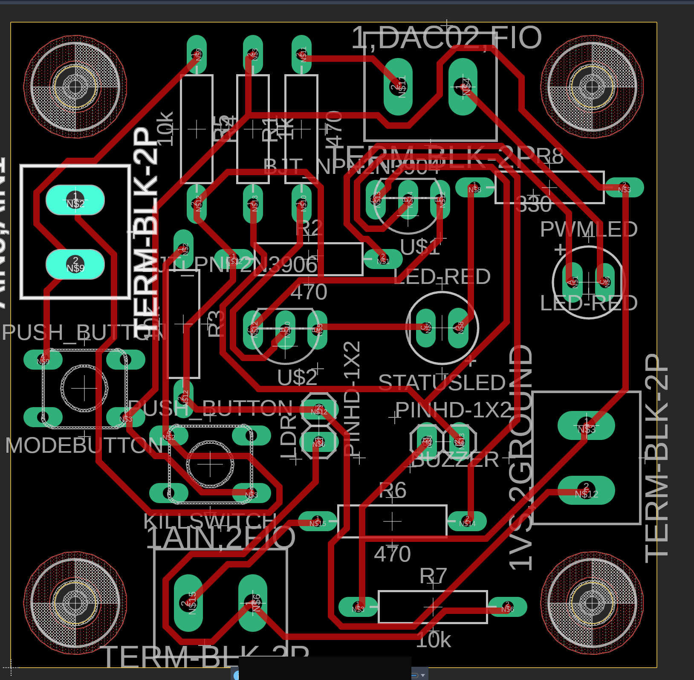

# Automatic Night Light

A 4-mode night light built in C on a **LabJack U3-HV** data-acquisition board, with a custom PCB designed in **Autodesk Fusion**.

Course project for HSI255 (Hardware–Software Interfacing), Seneca Polytechnic, Summer 2026.

## What it does

| Mode | LED behaviour |
|------|---------------|
| 0 – DIMMING | Brightness follows the room light from an LDR, with a smooth fade (darker room → brighter LED) |
| 1 – LOW | Blinks at 1 Hz |
| 2 – MID | Blinks at 2.5 Hz |
| 3 – HIGH | Blinks at 5 Hz |

- One **MODE** button cycles the modes: 0 → 1 → 2 → 3 → 0.
- On each press the piezo **buzzer** beeps (mode + 1) times, so you can hear which mode is active.
- A green **status LED** stays on while the program runs.
- A **kill switch** fades the LED off, resets the pins and ends the program.

## Hardware

| Signal | LabJack channel | Type |
|--------|-----------------|------|
| LDR (light sensor) | AIN0 | Analog input (voltage divider with 10 kΩ) |
| MODE button | AIN1 | Analog input, pull-down |
| Kill switch | AIN2 | Analog input, pull-down |
| Main LED (red) | FIO4 | Timer0, PWM8 |
| Piezo buzzer | FIO5 | Timer1, PWM8, driven by 2N3904 NPN |
| Status LED (green) | DAC0 | Analog out, driven by 2N3906 PNP (active-low) |

Schematic and PCB layout (Autodesk Fusion Electronics, two-layer through-hole):

| Schematic | PCB |
|-----------|-----|
|  |  |

The Fusion board file is in [`hardware/PCB.fbrd`](hardware/PCB.fbrd).

## How the code works

- **Two PWM timers** share one clock: 48 MHz base ÷ 47 divisor, both in 8-bit PWM mode → **3989 Hz** on FIO4 and FIO5. The U3 allocates timers from the pin offset upward, so the two PWM pins must be side by side (FIO4, FIO5).
- **Duty cycle** = (65536 − value) / 65536. For the LED, `0` = full bright and `65280` = off. For the buzzer, `32768` (50 %) is the loudest tone and `0` (a steady pin) is silence.
- **Blinking is done by counting loop passes** (25 ms each), not by slowing the PWM down. Slowing the shared clock would also change the buzzer pitch.
- **Button presses** are detected on the rising edge (previous reading low, current reading high), so holding the button does not keep changing modes.
- **Soft fade:** in DIMMING mode the PWM value moves 512 steps per pass toward the target instead of jumping, which gives a smooth change in brightness.
- All LabJack calls use the `AddRequest` / `Go` / `GetResult` pattern so the three analog reads happen in one USB transaction per loop.

## Build and run

Windows + Visual Studio (x86), with the LabJack UD driver installed.

1. Create an empty C++ project and add `src/NatchanonNightLight.c`.
2. Set the platform to **x86**.
3. Add `LabJackUD.lib` from `C:\Program Files (x86)\LabJack\Drivers\` (Project → Add → Existing Item), or add
   `#pragma comment(lib, "C:/Program Files (x86)/LabJack/Drivers/LabJackUD.lib")` to the source.
4. Connect the U3-HV over USB, build and run. Press any key to start, the MODE button to change mode, and the kill switch to exit.

## Lessons learned

- A PWM value of `0` means opposite things on the two timers (LED full on, buzzer silent). Keeping that straight in the comments saved a lot of debugging.
- Reviewing the schematic after routing found a reverse-biased LED and an LDR divider that was flipped relative to the code. Tracing each net from the component pins, and checking for junction dots, is the reliable way to catch this.
- Two terminal-block silkscreen labels did not match their real nets, so the wiring table in the report, not the silkscreen, is the source of truth for the board.

## Author

Natchanon (Jame) Nuansanit — Computer Engineering Technology, Seneca Polytechnic
